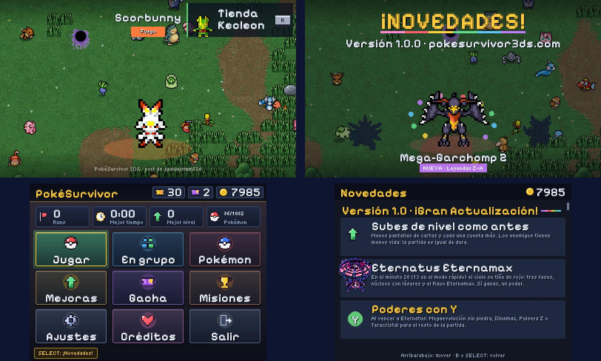
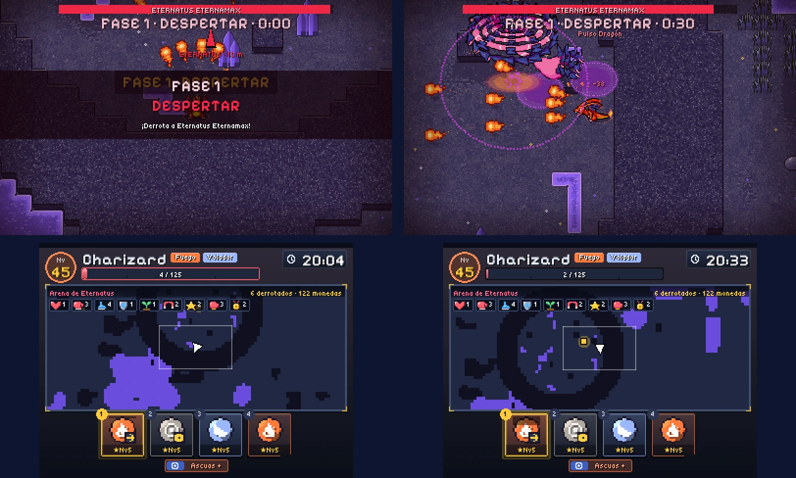
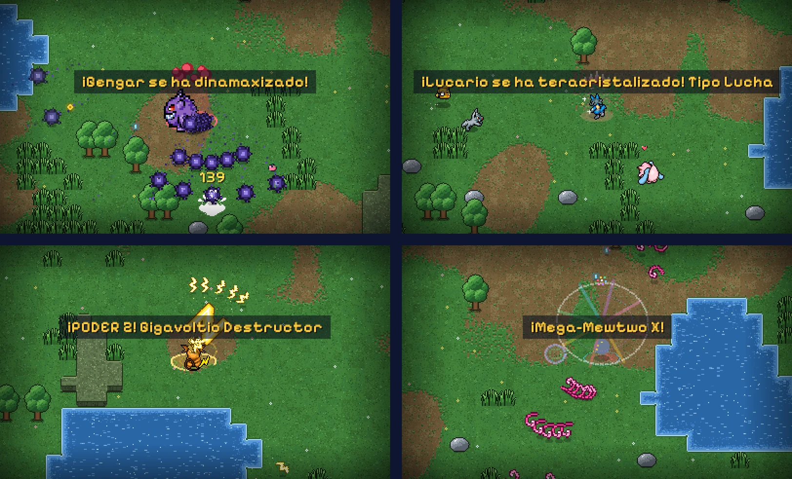
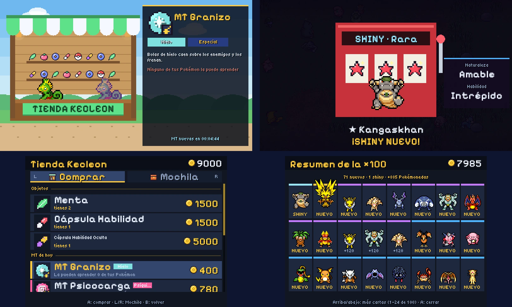
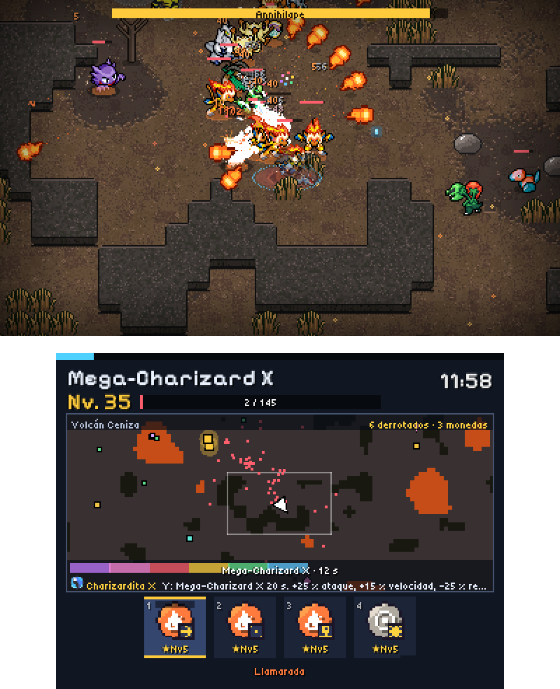
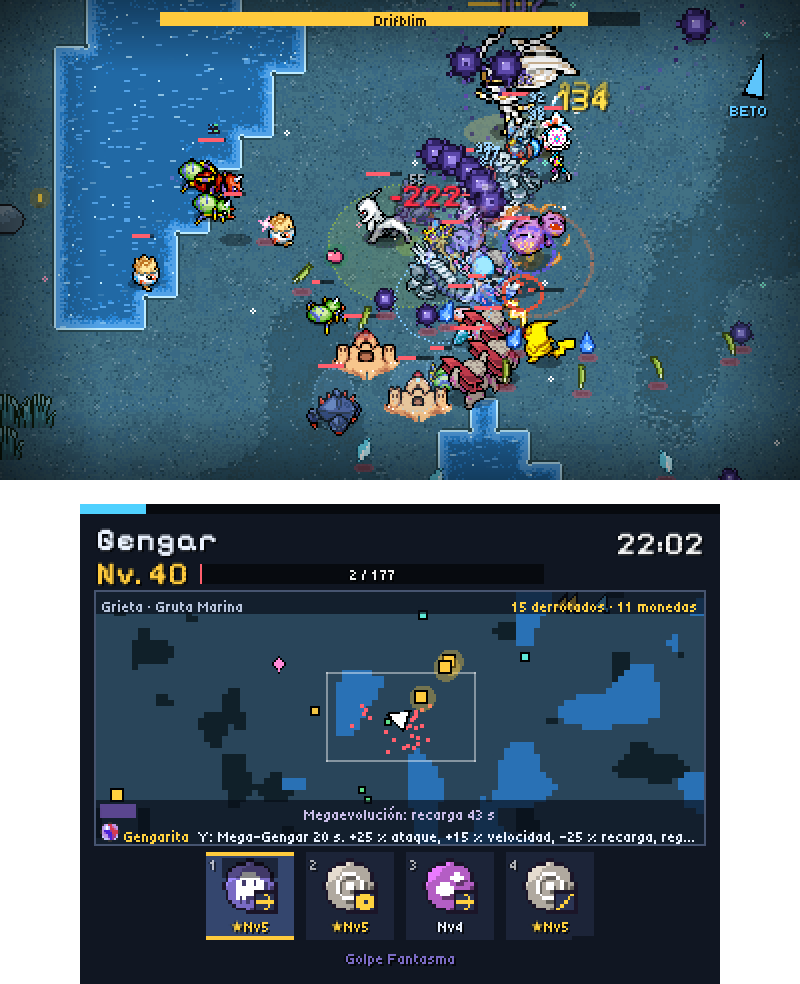

# PokéSurvivor 3DS

*[English](README.md) · Español*

Port **homebrew** para **Nintendo 3DS** de [PokéSurvivor](https://pokesurvivor.com),
el *bullet-heaven* con Pokémon y sprites de *Pokémon Mundo Misterioso*.
Es el mismo juego que la web —los 1025 Pokémon, los ataques, las grietas,
Eternatus, la Sentencia de Arceus, el gacha, las misiones y logros— hecho a
medida para la consola: dos pantallas, botones, pantalla táctil y 3D.

<p align="center">
  
</p>

**Web y descargas: [pokesurvivor3ds.com](https://www.pokesurvivor3ds.com)** ·
**Apoya el port: [Ko-fi](https://ko-fi.com/juanluismm521)** ☕

> Proyecto de fans **sin ánimo de lucro**, sin relación con Nintendo, Game Freak
> ni The Pokémon Company. Gratis siempre: no se puede vender ni poner anuncios.

## Lo nuevo de la 1.0: la Gran Actualización

<p align="center">
  <a href="https://www.pokesurvivor3ds.com/es/#v1"><b>▶ Mira el tráiler de la 1.0</b></a>
</p>

- **Eternatus Eternamax, el jefe del minuto 20** (del 13 en el modo rápido): el cielo
  se tiñe de rojo y te lleva a su arena. Tres fases, cuatro núcleos unidos por una
  barrera de láseres y el Rayo Eternamax. Si caes, se acaba la partida.
- **Véncelo y elige tu poder**, que usas con **Y** el resto de la partida:
  **Dinamax**, **Teracristal**, **Pulsera Z** o **Megaevolución** (Megaevolución +
  si ya llevas tu megapiedra).
- **Los 1025 Pokémon**, **57 formas regionales** (Alola, Galar, Hisui y Paldea),
  46 megas con sprite propio, **73 ataques nuevos** y 39 **ataques exclusivos**.
- **Los legendarios de la grieta pelean de verdad**: tres fases y cinco o seis ataques.
- **Tienda Kecleon** (MT, mentas, cápsulas de habilidad), el **desafío semanal** y
  las dificultades **Difícil** y **Pesadilla**.
- **Menú principal y pantalla táctil renovados**, con tus pasivas a la vista.
- **Gacha ×100** con naturaleza y habilidad en cada Pokémon.

<p align="center">
  
  
  
</p>

Todas las versiones, en [`CHANGELOG.md`](CHANGELOG.md) y en la pantalla de
**Novedades** del juego (SELECT en el menú principal).

## Qué tiene

### El juego
- **Toda la partida de la web**, portada a C++ y comprobada número a número con
  el código original: daño, tabla de tipos, experiencia, aparición de enemigos,
  el pintado del terreno, los movimientos, las misiones... (casos dorados).
- **Menús completos**: test de personalidad, compañero, colección (Pokédex con
  shinies), mejoras por Pokémon con atajos y vetos, **gacha con tragaperras** y
  selector de región (L/R), misiones, logros, estadísticas, ajustes y créditos.
- **Megaevoluciones** (del port): 91 megas con sus megapiedras.

<p align="center">
  
  
</p>
- **Pantalla de arriba**: la partida a 400×240, píxel exacto, con **3D**
  opcional (suelo al fondo, Pokémon delante).
- **Pantalla de abajo**: vida, nivel, reloj, tus ataques (tócalos para
  cambiar) y un **minimapa** con el terreno de verdad, lo que ves arriba, tú,
  tus compañeros, enemigos, jefes, cofres, altares, la grieta, Arceus...
  **Toca el mapa** para ver qué es cada icono.
- **Textos nítidos**: Pixelify Sans para lo grande y Tiny5 (8 px) para lo
  pequeño, siempre a escala entera.
- **Sonido**: la música y los efectos de la web, grabados de su sintetizador.
- **Calidad automática**: alta en la New 3DS, media en la 3DS vieja (el suelo
  se pinta en otro núcleo para no dar tirones). Se ve en Ajustes → Calidad.
- **Sin tirones**: los Pokémon nuevos se cargan en segundo plano.
- **Idiomas**: español e inglés (las traducciones de la web).

### Jugar en grupo (hasta 4 consolas)
En **En grupo**, con **L/R** eliges:
- **Cerca**: juego local de la 3DS, sin internet.
- **Por internet**: con cualquiera, a través de un **servidor de relevo**
  (ver más abajo). El servidor se configura en la propia consola (botón Y):
  IP o dominio y puerto.

Una consola crea la sala; las demás buscan y entran; el anfitrión pulsa
**¡Empezar!**. Reglas de la web: más enemigos y con más vida cuantos más
seáis, nivel y experiencia del equipo, las cartas salen a la vez y se espera a
todos, a un compañero caído se le levanta quedándose 3 s a su lado y la
partida acaba si caéis todos. Cada uno ve su Pokémon y a los demás con su
nombre, su color y una flecha cuando salen de la pantalla.

Por dentro es **lockstep**: cada consola manda sólo sus botones (8 bytes por
paso) y todas calculan exactamente la misma partida. Si una se desconecta,
las demás siguen; si alguna se separase, se avisa. Por internet, el retraso
de los controles se ajusta solo según el ping.

### La misma partida en la web y en la 3DS
**Ajustes → Cuenta de pokesurvivor.com → Entrar** con tu usuario y contraseña
de la web. Las dos partidas **se juntan sin perder nada** (Pokémon, shinies,
mejoras, logros...) igual que lo hace la web entre dos
ordenadores, y después se sincroniza sola al encender y al acabar cada partida,
o con «Sincronizar ahora». En la web, recarga la página para ver lo de la 3DS.

- Con **usuario y contraseña**, o con **Google** escaneando un QR. La
  contraseña **no se guarda**: sólo un token de sesión.
- **Lo que ganas lo paga pokesurvivor.com**, como en la web: cada partida queda
  apuntada en la SD y se cobra al sincronizar (también si jugaste sin conexión).
- **Con cuenta, el gacha necesita conexión**: las tiradas se hacen en el
  servidor de pokesurvivor.com, como en la web, para evitar trampas. Sin
  cuenta, el juego es 100 % local.
- **A prueba de actualizaciones de la web**:
  - si la web cambia el formato de la partida, la 3DS no toca nada y pide
    actualizar el juego;
  - lo que la 3DS no conoce (Pokémon, mejoras, monedas o campos nuevos)
    **nunca se borra** y no se recorta nada a los máximos de la 3DS;
  - la 3DS sólo escribe lo que ella ha cambiado;
  - si una fusión fuera a perder algo, no se sube nada;
  - antes de cada sincronización guarda copias en la SD.

## Instalar en la consola
1. Una 3DS con *custom firmware* (Luma3DS).
2. Elige una de las formas (todas usan la misma partida):
   - **Con el QR (sin cables):** abre **FBI** → **Remote Install** → **Scan QR
     Code**, apunta la cámara de la 3DS a este QR y acepta. Instala siempre la
     última versión.

     
   - **En el menú HOME, como un juego más** (con su icono, banner y sonido):
     copia `pokesurvivor-3ds.cia` a la SD, abre **FBI** → *SD* → el archivo →
     *Install CIA*. Sale en el menú principal; se borra desde Configuración
     de la consola → Gestión de datos → Programas, o con FBI → *Titles*.
   - **Desde el Homebrew Launcher:** copia `pokesurvivor-3ds.3dsx` a `sd:/3ds/`.
   - **Actualizaciones:** el juego busca solo las versiones nuevas al
     encender, las descarga (firmadas por el proyecto) y se instalan **al
     salir del juego**. Sólo baja **lo que cambia** (un parche contra la
     versión que tienes en la SD: normalmente 1 o 2 MB en vez de 40). En **Ajustes → Actualizaciones**: «Instalar ahora» y
     «Volver a la versión anterior».
3. Para el sonido hace falta `sd:/3ds/dspfirm.cdc` (se saca una vez con DSP1).
4. Para jugar por internet y sincronizar con la web, la consola necesita wifi.

Archivos que el juego usa en `sd:/3ds/pokesurvivor-3ds/`:

| Archivo | Qué es |
|---|---|
| `save.json` (+ `save.bak`) | tu partida (el mismo formato que la web) |
| `settings.json` | ajustes (también el servidor para jugar online) |
| `cuenta.json` | la sesión de pokesurvivor.com (sin contraseña) |
| `save.antes-de-sincronizar.json`, `nube.copia.json` | copias de seguridad de la última sincronización |

## Controles
| Botón | Acción |
|---|---|
| Circle Pad / cruceta | Moverse |
| L / R (o X, ZL/ZR) | Cambiar de ataque (o tocar el hueco abajo) |
| START | Pausa (SELECT en la pausa: abandonar la partida) |
| Arriba/abajo + A, o tocar | Elegir carta de nivel, objeto o vínculo |
| Y | Usar tu poder (Megaevolución, Dinamax, Teracristal, Pulsera Z) · en las cartas de nivel: cambiarlas |
| Tocar el minimapa | Leyenda del mapa |
| START + SELECT | Salir del juego |

En grupo, START no para la partida (te quedas quieto).

## El servidor para jugar online
Está en **su propio repositorio, [pokesurvivor3ds-server](https://github.com/juanluismm521/pokesurvivor3ds-server)**: un solo archivo de
Python con **Docker** y una guía sencilla para montarlo (VPS, Raspberry Pi o
PC de casa). Por defecto la consola usa el del proyecto; cada uno puede poner
el suyo en **En grupo → Por internet → Y**.

## Compilar
Todo se hace en Linux (en el proyecto, un VPS sin pantalla):

```bash
tools/setup_vps.sh                       # devkitPro (imagen Docker oficial), Node, Python, Azahar...
source tools/env.sh && make              # → pokesurvivor-3ds.3dsx
tools/make_cia.sh                        # → pokesurvivor-3ds.cia (menú HOME; baja makerom y bannertool)
cmake -S . -B build-pc && cmake --build build-pc -j2 && (cd build-pc && ctest)   # pruebas en PC
```

El código original de la web **no va en este repositorio** (es de su autor).
Sí van las tablas del juego que se generan de él (`src/gen/gamedata.cpp`,
`tests/web-generado/`), así que el código C++ y las pruebas de PC compilan sin
él. Para rehacer los recursos de la consola (`tools/build_assets.sh`: sprites,
arte, música) y los casos dorados hace falta una copia de la web en
`reference/web/`.

Las pruebas del juego online usan el servidor
([pokesurvivor3ds-server](https://github.com/juanluismm521/pokesurvivor3ds-server));
CMake lo busca al lado de este repositorio (se cambia con
`-DPS_RELAY_PY=ruta/relay.py`).

## Cómo se ha probado
Cada parte tiene pruebas, y una tarea no se da por hecha hasta que pasan:
- **Casos dorados**: el JS original de la web se ejecuta en node y sus
  resultados se comparan con los del port (daño, tipos, experiencia, terreno,
  movimientos, gacha, misiones, i18n, la fusión de partidas de `db.js`...).
- **Simulación sin pantalla** con AddressSanitizer y UBSan: un bot juega
  partidas enteras (hasta la Sentencia, también de 3 jugadores) sin cuelgues,
  NaN ni fugas, y sin pasar los topes.
- **Cooperativo**: varias "consolas" en el mismo programa con una red falsa
  (retraso, pérdidas, desorden, desconexiones) que nunca se separan; y con el
  **servidor de verdad**.
- **Emulador Azahar** (bajo Xvfb): capturas de cada pantalla, autotest con FPS
  y memoria, partidas de 30 min, **dos consolas emuladas jugando juntas** en
  local y por internet con las mismas huellas.
- **Sincronización**: la **web original** en Chromium contra el emulador de
  Firebase y la "3DS" en medio; una web "del futuro" que pasa por la 3DS sin
  perder nada; y HTTPS con los servidores reales de Google desde la consola
  emulada.

## Qué hay en el repositorio
| Carpeta | Qué es |
|---|---|
| `src/core/` | El juego en C++17, sin nada de la 3DS (se compila también en Linux): partida, lockstep, fusión de partidas, cliente de la nube y del servidor |
| `src/platform/3ds/` | Gráficos (citro2d), sonido (ndsp), botones y táctil, juego local (UDS), red (curl + mbedTLS), menús, minimapa |
| `tests/` | Pruebas (doctest): sueltas, casos dorados, simulación, cooperativo, online, nube |
| `tools/` | Generadores de la web a formatos de la 3DS, casos dorados, emulador, pruebas de grupo y de la nube |
| `assets-src/` | Sprites PNG originales, fuentes e icono |
| `docs/` | Notas e imágenes |

Documentos: [`GDD.md`](GDD.md) (diseño del juego) y
[`CHANGELOG.md`](CHANGELOG.md) (todas las versiones).

## Licencias y créditos
- Gracias ante todo a **JPTER78**, creador de PokéSurvivor
  ([pokesurvivor.com](https://pokesurvivor.com)).
- Port de 3DS: **[juanluismm521](https://github.com/juanluismm521)** ·
  [Ko-fi](https://ko-fi.com/juanluismm521).
- Código: PolyForm Noncommercial 1.0.0 (`LICENSE`, `LICENSE-NONCOMMERCIAL.md`).
- Sprites: PMD Sprite Collab, CC BY-NC 4.0. Todos los artistas en
  [`CREDITS.md`](CREDITS.md); también salen en el juego.
- Fuentes: Pixelify Sans y Tiny5 (SIL OFL, `assets-src/fonts/`).
