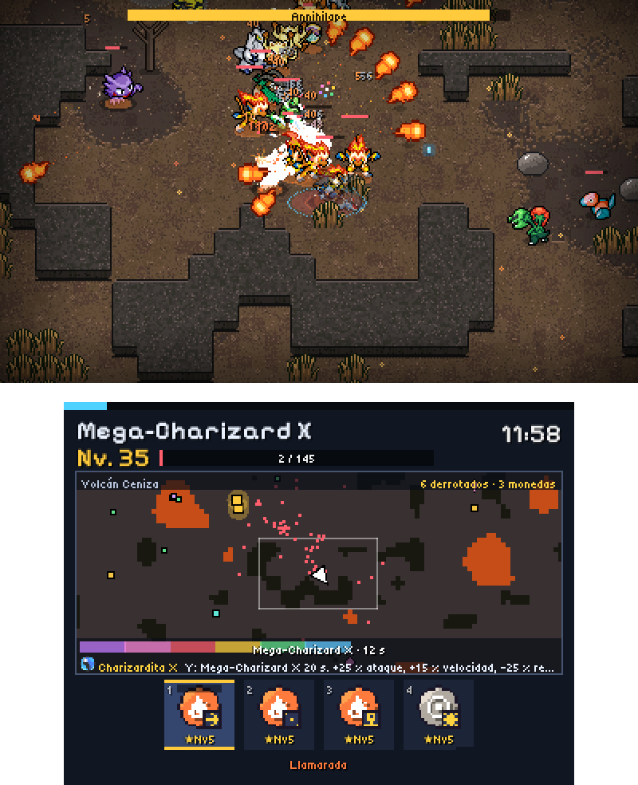
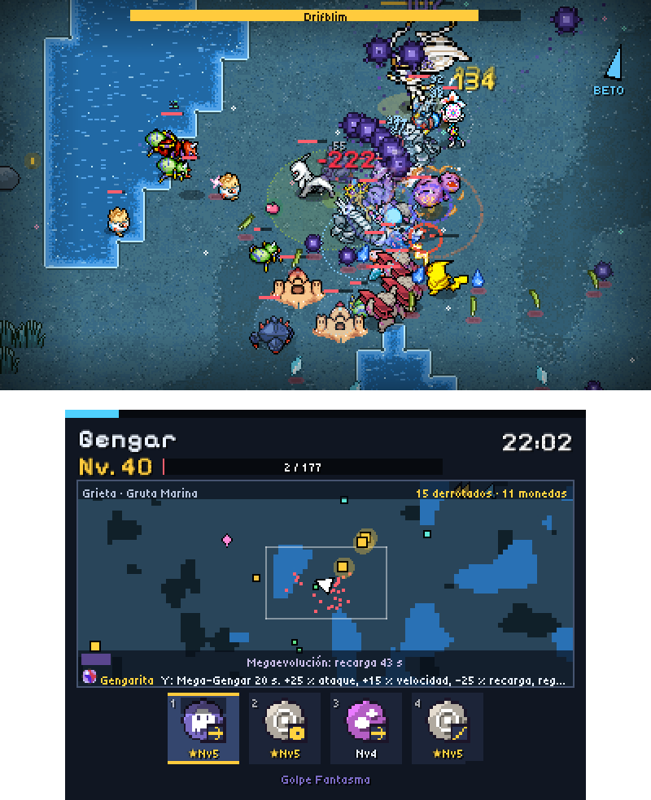

# PokéSurvivor 3DS

*English · [Español](README.es.md)*

A **homebrew** port for the **Nintendo 3DS** of [PokéSurvivor](https://pokesurvivor.com),
the Pokémon *bullet-heaven* with *Pokémon Mystery Dungeon* sprites. It is the
same game as the web version —all 966 Pokémon, the moves, rifts, Arceus'
Judgment, the gacha, missions and achievements— tailored to the console: two
screens, buttons, touch screen and 3D.

<p align="center">
  
  
</p>

**Website and downloads: [pokesurvivor3ds.com](https://www.pokesurvivor3ds.com)** ·
**Support the port: [Ko-fi](https://ko-fi.com/juanluismm521)** ☕

> A **non-profit** fan project, not affiliated with Nintendo, Game Freak or
> The Pokémon Company. Always free: it may not be sold or carry ads.

## Install on the console
You need a 3DS with custom firmware (Luma3DS). Both ways use the same save.

### A. With the QR code (no cables)
1. Open **FBI** → **Remote Install** → **Scan QR Code**.
2. Point the 3DS camera at this QR code and confirm.

<p align="center"></p>

It always installs the latest version
(`http://pokesurvivor3ds.duckdns.org/datos/programa/ultimo.cia`).

### B. Copying the files
- **On the HOME Menu, like any other game** (with its icon, banner and
  sound): copy `pokesurvivor-3ds.cia` to the SD card and open **FBI** → *SD* →
  the file → *Install CIA*.
- **From the Homebrew Launcher:** copy `pokesurvivor-3ds.3dsx` to `sd:/3ds/`.

Downloads are on [pokesurvivor3ds.com](https://www.pokesurvivor3ds.com).

### Notes
- **Updates:** the game looks for new versions by itself on boot, downloads
  them (signed by the project) and installs them **when you quit**. It only
  downloads **what changes** (a patch against the version on your SD card,
  usually 1-2 MB instead of 40 MB).
  **Settings → Updates** has «Install now» and «Go back to the previous version».
- **Sound** needs `sd:/3ds/dspfirm.cdc` (dump it once with DSP1).
- **Online play** and **web sync** need Wi-Fi.

## Features

### The game
- **The whole web game**, ported to C++ and checked number by number against
  the original code: damage, type chart, experience, enemy spawns, terrain
  painting, moves, missions... (golden tests).
- **Complete menus**: personality test, partner, collection (Pokédex with
  shinies), per-Pokémon upgrades, **slot-machine gacha** with a region
  selector, missions, achievements, stats, settings and credits.
- **Mega Evolutions** (a port extra): 91 Megas with their Mega Stones.
- **Top screen**: the game at 400×240, pixel-perfect, with optional **3D**.
- **Bottom screen**: health, level, timer, your moves (tap to switch) and a
  **minimap** with the real terrain, your teammates, enemies, bosses, chests,
  altars, the rift, Arceus... **Tap the map** for a legend.
- **Sound**: the web's music and sound effects, recorded from its synth.
- **Automatic quality**: high on New 3DS, medium on the old 3DS.
- **Languages**: English and Spanish.

### Play in a group (up to 4 consoles)
In **Play in a group**, **L/R** switches between:
- **Nearby**: 3DS local wireless, no internet needed.
- **Online**: with anyone, through the project's server. Rooms can have a
  password and a «fast» mode.

One console creates a room, the others join, and the host presses **Start!**.
More and tougher enemies the more players, shared team level, level-up cards
for everyone at once, and a downed teammate is revived by standing next to
them for 3 s.

Under the hood it is **lockstep**: each console only sends its button presses
and they all compute exactly the same game. Online, the server gathers
everyone's inputs and adjusts the delay to each player's connection.

### The same save on the web and on the 3DS
**Settings → pokesurvivor.com account → Log in** with your web username and
password (or with Google by scanning a QR code). Both saves are **merged
without losing anything** (Pokémon, shinies, coins, tickets, upgrades,
achievements...) and then it syncs by itself on boot and after every run.

- The password is **never stored**, only a session token.
- **Safe against web updates**: anything the 3DS doesn't know is **never
  deleted**, the 3DS only writes what it changed, and if a merge would lose
  anything, nothing is uploaded. Backups are written to the SD card before
  every sync.

Files in `sd:/3ds/pokesurvivor-3ds/`:

| File | What it is |
|---|---|
| `save.json` (+ `save.bak`) | your save (same format as the web) |
| `settings.json` | settings (including the online server) |
| `cuenta.json` | the pokesurvivor.com session (no password) |
| `save.antes-de-sincronizar.json`, `nube.copia.json` | backups of the last sync |

## Controls
| Button | Action |
|---|---|
| Circle Pad / D-Pad | Move |
| L / R (or X, ZL/ZR) | Switch move (or tap the slot below) |
| START | Pause (SELECT while paused: quit the run) |
| Up/down + A, or tap | Pick a level-up card, item or bond |
| Y | Mega Evolve (with the Mega Stone equipped) · on level-up cards: reroll |
| Tap the minimap | Map legend |
| START + SELECT | Exit the game |

When playing together, START doesn't stop the game (you just stand still).

## The online server
It lives in **its own repository,
[pokesurvivor3ds-server](https://github.com/juanluismm521/pokesurvivor3ds-server)**:
a single Python file with **Docker** and an easy setup guide (VPS, Raspberry Pi
or home PC). By default the console uses the project's server; anyone can set
their own in **Play in a group → Online → Y**.

## Building
Everything is built on Linux:

```bash
tools/setup_vps.sh                       # devkitPro (official Docker image), Node, Python, Azahar...
source tools/env.sh && make              # → pokesurvivor-3ds.3dsx
tools/make_cia.sh                        # → pokesurvivor-3ds.cia
cmake -S . -B build-pc && cmake --build build-pc -j2 && (cd build-pc && ctest)   # PC tests
```

The original web code is **not included** in this repository (it belongs to
its author). The game tables generated from it are included
(`src/gen/gamedata.cpp`, `tests/web-generado/`), so the C++ code and the PC
tests build without it. Rebuilding the console assets (`tools/build_assets.sh`:
sprites, art, music) and the golden tests needs a copy of the web code in
`reference/web/`.

The online tests use the server
([pokesurvivor3ds-server](https://github.com/juanluismm521/pokesurvivor3ds-server));
CMake looks for it next to this repository (change it with
`-DPS_RELAY_PY=path/relay.py`).

## Testing
- **Golden tests**: the web's original JS runs in Node and its results are
  compared with the port's (damage, types, experience, terrain, moves, gacha,
  missions, save merging...).
- **Headless simulation** with AddressSanitizer and UBSan: a bot plays whole
  runs (also with 3 players) with no hangs, NaNs or leaks.
- **Co-op**: several "consoles" in one program over a fake network (delay,
  loss, reordering, disconnections) that never desync, and against the real
  server.
- **Azahar emulator** (under Xvfb): screenshots, autotests with FPS and memory,
  30-minute runs and **two emulated consoles playing together**.
- **Sync**: the original web in Chromium against the Firebase emulator with
  the "3DS" in the middle.

## What's in the repository
| Folder | What it is |
|---|---|
| `src/core/` | The game in C++17, with nothing 3DS-specific (it also builds on Linux): game logic, lockstep, save merging, cloud and server clients |
| `src/platform/3ds/` | Graphics (citro2d), sound (ndsp), buttons and touch, local play (UDS), network (curl + mbedTLS), menus, minimap |
| `tests/` | Tests (doctest): unit, golden, simulation, co-op, online, cloud |
| `tools/` | Converters to 3DS formats, golden tests, emulator, co-op and cloud tests, publishing |
| `assets-src/` | Original PNG sprites, fonts and icon |
| `docs/` | Notes and images |

[`GDD.md`](GDD.md) has the game design (in Spanish) and
[`CHANGELOG.md`](CHANGELOG.md) every version.

## Licenses and credits
- Thanks above all to **JPTER78**, creator of PokéSurvivor
  ([pokesurvivor.com](https://pokesurvivor.com)).
- 3DS port by **[juanluismm521](https://github.com/juanluismm521)** ·
  [Ko-fi](https://ko-fi.com/juanluismm521).
- Code: PolyForm Noncommercial 1.0.0 (`LICENSE`, `LICENSE-NONCOMMERCIAL.md`).
- Sprites: PMD Sprite Collab, CC BY-NC 4.0. All artists in
  [`CREDITS.md`](CREDITS.md); they are also shown in the game.
- Fonts: Pixelify Sans and Tiny5 (SIL OFL, `assets-src/fonts/`).
